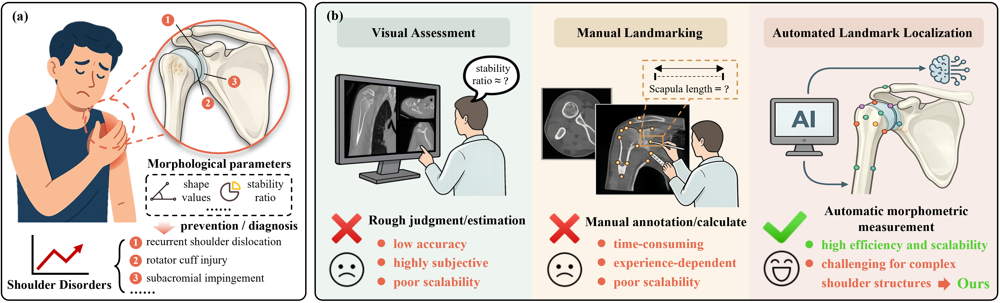
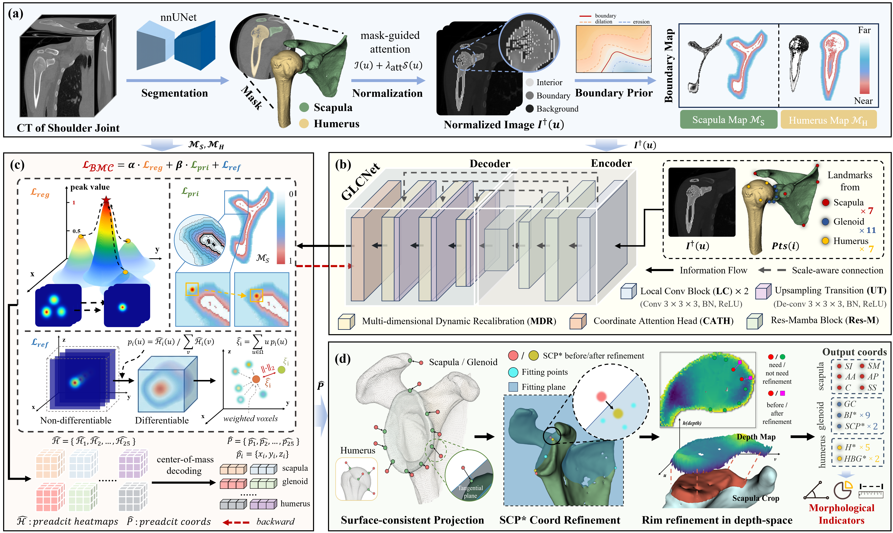

# AMOR: Shoulder Landmark Localization and Morphometric Analysis

Official implementation of **AMOR**, a geometry-consistent and anatomy-aware framework for CT-based shoulder landmark localization and objective morphometric analysis.

AMOR localizes scapula and humerus landmarks from 3D shoulder CT volumes using **GLCNet**, a Global-to-Local Coordinate-aware Network, and supervises heatmap prediction with the paper-aligned **Boundary-constrained Morphology Coordinate Loss (BMC Loss)**.

## Overview



**Figure 1.** Clinical motivation and workflow comparison for quantitative shoulder morphometric assessment.



**Figure 2.** Overview of AMOR, including structural prior-guided input enhancement, GLCNet landmark regression, BMC Loss, and anatomy-constrained post-processing.

## Installation

Create a Python environment and install the project dependencies:

```bash
pip install -r requirements.txt
```

The project depends on PyTorch, SimpleITK, scikit-image, tensorboard, and `mamba-ssm`. Please install a PyTorch and CUDA version compatible with your local GPU environment before installing `mamba-ssm`.

## Data Format

Each data split should follow this structure:

```text
<DATA_ROOT>/
|-- train/
|   |-- img/
|   |-- seg/
|   |-- scapula/
|   `-- humerus/
|-- valid/
|   |-- img/
|   |-- seg/
|   |-- scapula/
|   `-- humerus/
`-- test/
    |-- img/
    |-- seg/
    |-- scapula/
    `-- humerus/
```

Expected files:

- `img/`: CT volumes in `.nii.gz` or `.nrrd` format.
- `seg/`: segmentation volumes aligned with the CT volumes.
- `scapula/`: scapula landmark JSON files.
- `humerus/`: humerus landmark JSON files.

Landmark JSON files can be either a list of `{label, position}` records or a 3D Slicer Markups JSON file.

## Training

Edit [config/train.json](config/train.json), especially:

- `datasets.train.trainroot`
- `datasets.train.validroot`
- `datasets.train.cacheroot`
- `datasets.train.points_part`
- `path.checkpoint`

Then run:

```bash
python train.py --config config/train.json
```

The training script saves checkpoints under `path.checkpoint` and logs scalar losses through TensorBoard.

## Inference and Evaluation

Edit [config/test.json](config/test.json), especially:

- `path.resume_state`
- `datasets.test.testroot`
- `datasets.test.cacheroot`
- `datasets.test.points_part`
- `datasets.test.use_labels`

Run inference:

```bash
python test.py --config config/test.json
```

When `use_labels` is `true`, the script reports landmark localization errors and BMC loss terms. When `use_labels` is `false`, it only exports predicted landmarks and heatmaps.

## Outputs

For each test case, predictions are saved under `path.results`:

```text
results/
`-- <case_id>/
    |-- landmarks.json       # 3D Slicer-compatible predicted landmarks
    |-- <landmark>.nii.gz    # Predicted heatmap for each landmark
    `-- ...
```

## Post-processing

The `postprocess/` directory contains utilities for:

- surface-consistent landmark projection,
- scapula uvh-based local refinement,
- millimeter-space error calculation,
- morphometric parameter computation,
- summary statistics.

These tools are optional and can be run after landmark prediction depending on the downstream analysis protocol.
